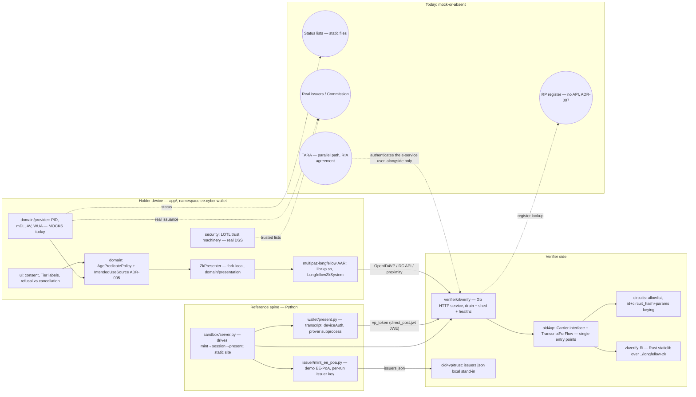

# eudi-wallet-poc — architecture record

The consistency contract for the backlog in `_bmad-output/planning-artifacts/epics.md`:
the invariants that keep independently-implemented stories from diverging, the
decisions Stories 3.1, 3.3/3.4, 4.1 and 5.1 deferred to this record (ADR-004 …
ADR-008), the mock→real seams, and the corrections where the imported
`docs/ARCHITECTURE.md` no longer matches the tree. Working memory for this run:
`_bmad-output/planning-artifacts/architecture/.memlog.md`.

**Identifier namespaces.** The PRD numbers requirements `FR-n`/`NFR-n`; the
backlog numbers its own `FR1`–`FR70`/`NFR1`–`NFR16` (PRD assumption A-6).
Neither is renumbered. This record joins on **story ids** (`Story 3.1`, …) —
stable, unique, what the sprint tracker and coverage map join on — and cites
requirements either by the spec's `EE-<AREA>-<nnn>` (normative) or with an
explicit prefix (`PRD FR-9`, `backlog FR9`) when quoting one of the two
documents.

**Design paradigm, named.** Fail-closed reference spine: every trust decision
is an explicit refusal away from an allow, every refusal names its cause, and
the specification — not the code's current behaviour — is the authority both
match (the imported `docs/ARCHITECTURE.md` §1's rule, carried forward).

**Readiness gate closure.** `epics.md`'s Overview records one CONCERNS
finding: no architecture record exists, so Stories 3.1, 4.1 and 5.1 each
open by making their own decision. This record closes it: ADR-004 (Story
3.1), ADR-005 (Stories 4.1/4.2), ADR-006 (Story 5.1), with ADR-007
(Stories 3.3/3.4) and ADR-008 (PRD OQ-6) closing the adjacent
interface-before-implementation gaps. Flipping the gate line in `epics.md`
itself from CONCERNS to PASS is a story-document edit this run does not
make (it is a separate step for the maintainer); this paragraph is the
closure evidence to cite when it is made.

## 1. Component and trust-boundary map

Trust boundaries, one line each — who must trust what, and what must not be
trusted:

- **Holder → verifier:** the wallet signs `deviceAuth` over the recomputed
  transcript; the verifier trusts **only its own** session state (nonce,
  `expected_now`, transcript recomputation — never a wallet-supplied `now`).
- **Verifier → holder:** `direct_post.jwt` default (ADR-003): the ~360 KB proof
  travels in a JWE to the verifier's P-256 response key, whose thumbprint is
  inside the transcript. Plain `direct_post` is an explicit operator
  downgrade, never a supported deployment mode.
- **Verifier trust roots:** the circuit allowlist (`EE-ZKP-023/030`, checked
  before proof verification) and the local issuer trust store — both local
  stand-ins today (`verifier/circuits.json` and the `-issuers` file, a
  run-directory artifact the issuer and `tests/e2e.sh` write, not a
  committed production store); the real roots are the scheme-owner circuit
  list (ADR-006) and the LoTE + Art. 22 trusted lists (`EE-GOV-010`).
- **Wallet trust roots:** the reader authentication chain
  (`EE-PRO-025` readerAuth → trusted access CA) and the EU LOTL via DSS — the
  machinery is real; the issuers it vouches for in the demo build are the
  fork's own.
- **Verifier → nothing persisted:** sessions and (per ADR-006) the provenance
  ring are in memory only; the retention boundary is process lifetime.

### 1.1 Corrections to `docs/ARCHITECTURE.md`

The imported document describes ee-eudiw at `e368fc1` (12 September 2026).
Verified drift, each re-checked against the tree in this run:

| `docs/ARCHITECTURE.md` says | Tree today | Where verified |
|---|---|---|
| "no wallet application… no Android holder" | `app/` is in this tree: Kotlin/Gradle, namespace `ee.cyber.wallet`, applicationId `ee.tomkabel.walletpoc`, modules crypto/data/di/domain/security/ui/util | `app/build.gradle.kts:24-36` |
| verifier gaps include "`direct_post` not `direct_post.jwt`" | `direct_post.jwt` is the default; plain mode behind explicit flags (ADR-003) | `verifier/go/main.go:382-391,438-447` |
| "no revocation or status checking" | token-status list files exist and the provider mocks consume them (still mock-grade) | `statuslists/1`, `statuslists/2`; provider mocks |
| spec "193 normative requirements, revision 1.5" | 211 requirements, content revision 1.7 | `spec/EE-EUDIW-TS-1.0.md` rev table |
| (absent) | SIGTERM drain: 503 + `Retry-After` on `/present/new`, `draining: true` on `/healthz`, drain budget default 2×TTL | `main.go:583-671`, `tests/drain_test.sh` |
| (absent) | multi-credential sessions (`-multi-credentials`, `-max-credentials`), carrier sniff dispatch, dcapi path | `present.go`, `carrier.go`, `iso.go` |

`docs/ARCHITECTURE.md` stays as the imported source with its own import note;
this record is the fork's architecture of record.

## 2. Decisions (ADR-004 … ADR-008)

| ADR | Fixes | Unblocks | Story acceptance criteria now "follow the ADR" |
|---|---|---|---|
| [ADR-004](../docs/decisions/ADR-004-RP-KIT-DEPLOYMENT-PROFILE.md) `rp-kit/` deployment profile | what the RP service is: the existing `zkverify` binary under a documented profile — flag set, persisted response key, drain-as-rotation, session-closure body, TARA alongside | Epic 3 | Story 3.1 (FR9); 3.2/3.8's parallel-path premise |
| [ADR-005](../docs/decisions/ADR-005-INTENDED-USE-SOURCE.md) `IntendedUseSource` + certificate model | the wallet-side interface: sealed fail-closed result, typed `RegisteredIntendedUse`, no wallet-side cache, version-pinned profile, `version-unsupported` refusal | Epic 4 | Story 4.1 (FR16), 4.2 (FR17) |
| [ADR-006](../docs/decisions/ADR-006-CIRCUIT-LIST-DOCUMENT.md) signed circuit list | one checkable document: `ee-circuits/1`, Ed25519 over JCS, envelope fields, same-format local fallback, named refusals, in-memory provenance ring, community-maintained while no scheme owner | Epic 5 | Story 5.1 (FR21), 5.2, 5.3, 5.5 |
| [ADR-007](../docs/decisions/ADR-007-RP-REGISTER-LOOKUP.md) RP-register lookup | one Go interface mirroring ADR-005's model; three distinct refusal errors; 15-minute published cache TTL; stale-beyond-TTL = absent | Epic 3 | Story 3.3 (FR11), 3.4 (FR12), 3.5's unregistered case |
| [ADR-008](../docs/decisions/ADR-008-CARRIER-PATH-PLACEMENT.md) two-carrier placement | DC API = mandated ZK path; OpenID4VP `mso_mdoc_zk` = profiled-but-unofficial; enforcement: profile-doc headers, runner report labels, `Carrier.Name()` | Epics 1, 2, 7 | PRD OQ-6 as a rule; Story 1.3/2.1 labels, 7.4 vocabulary |

Existing ADRs stay load-bearing: ADR-002 (strict CBOR subset decoder) and
ADR-003 (minimal JWE, `direct_post.jwt` default) — both in `docs/decisions/`;
ADR-001 is upstream ee-eudiw's (`ADR-001-submodules.md`, per
`docs/planning/EE-EUDIW-ZK-IMPORT-PLAN.md:223`), which is why this run starts
at ADR-004.

### 2.1 Positions taken on the PRD's open questions

- **OQ-6 (two carriers)** — architectural; decided as ADR-008 above.
- **OQ-11 (proximity advertising after refusal)** — **product decision, left
  open.** The architectural constraint is recorded: whatever is decided, the
  proximity surface must not present a ZK age request as available where
  `EE-ZKP-055a`/`EE-PRO-025` would refuse it, and the refusal-vs-advertising
  split is one decision, not two independent ones.
- **OQ-12 (sandbox hosting)** — **product/operations decision, left open.**
  The constraint: a hosted run is not a third-party reproduction (NFR8), and
  any hosted instance must label hosted-run results as such, distinct from
  the reproduction instructions.
- **OQ-2 (circuit-set ownership)** — the architectural half is decided
  (ADR-006's community-maintained interim position + succession); who *adopts*
  it stays open and is Story 5.6's own path.

## 3. Mock→real seams

Every seam where the tree is mock-or-file-backed today. "Enforced by" is what
keeps the boundary honest meanwhile.

| # | Seam | Today (mock) | Replaced by | Enforced by | Must not be presented as |
|---|---|---|---|---|---|
| 1 | PID provider | `PidProviderServiceMock` (+ `…Rpc`) | real PID issuance over OpenID4VCI (backlog FR55) | the `local_mocks` build variant (`app/build.gradle.kts:104`); CI runs `:app:testLocal_mocksUnitTest` | real PID issuance |
| 2 | mDL provider | `MdlProviderServiceMock` | same class of issuer service (FR55) | same variant | real mDL issuance |
| 3 | AV attestation | `AgeVerificationProviderServiceMock` + `WalletProviderBatchAgeIssuer` | AV attestation provider issuing `eu.europa.ec.av.1`, AVSUA-equivalent (`EE-WUA-008`, FR56) | same variant | real AV attestation |
| 4 | Wallet Unit Attestation | `WalletProviderServiceMock` (+ `…Rpc`) | WUA providers per `EE-WUA-007`/`008` (FR57) | same variant | real WUA |
| 5 | Python spine issuer | `issuer/mint_ee_poa.py`: per-run in-memory issuer key; `demo-data/` holds the device private key | the Commission's issuer service (FR55) | `demo-data/` gitignored (policy); NFR9 secretless build | an issuer of record |
| 6 | RP register | nothing — ADR-007's file-backed mock to come | RIA register API (unpublished; PRD OQ-3) | ADR-007's fail-closed interface — unconfigured = refuse | a live register |
| 7 | Status list | `statuslists/{1,2}` static files | a real status list with revocation, revoked fixture (FR58, `EE-REV-007` cache-age rule) | the files are test fixtures, catalogued in `tests/README.md` | live revocation |
| 8 | Verifier trust store | the `-issuers` file (default `issuers.json`): local, unsigned, written into the run directory by the issuer / `tests/e2e.sh`, read once at startup, fails closed | LoTE + Art. 22 trusted lists (`EE-GOV-010`) | trust comes from the store and nowhere else (`oid4vp/trust.go`); no committed production store exists | a production trust anchor |
| 9 | Wallet issuer-trust config | real DSS LOTL machinery (`FetchLOTLCertificates`, served from the fork's own Maven mirror) wired to demo trust config in the demo build | national trusted lists | the LOTL code path is real and shared with upstream | — (machinery real, inputs mock) |
| 10 | Circuit allowlist | `verifier/circuits.json`, unsigned local stand-in | the signed document of ADR-006, scheme owner unknown (OQ-2) | allowlist checked before verification; ADR-006 refusals | scheme-owner authority |

## 4. Invariants the backlog's Additional Requirements impose — all preserved

Verified in code before this record repeated them (see the memlog constraint
entries for the `file:line` evidence): the `Carrier` interface + sniff dispatch
as the single ISO-2e adaptation point; `TranscriptForFlow` as the single
transcript entry point with flow mixing structurally banned; the
`id`+`circuit_hash`+params allowlist keying with both system labels
(preserved verbatim by ADR-006 — `circuits[]` is the existing struct);
`direct_post.jwt` as the default, carried into the rp-kit profile unchanged
(ADR-004); the ABI restriction `arm64-v8a` + `x86_64` (installable = provable);
and the plan-records-in-`docs/planning/`/indexing discipline. No backlog
prohibition is changed by this record.

## 5. Deferred (not decided here)

- Stack, tree layout and per-module internals — seed owned by the code; the
  component map above states only what crosses a boundary.
- TARA's concrete adapter surface (Story 3.2's own contract, gated on the RIA
  agreement) — ADR-004 fixes only its placement: alongside, never inside.
- Which ARF revision ADR-005's in-repo certificate profile pins — mechanical
  answer is the `eudi-arf` submodule pin; revisit when OQ-3 lands or the pin
  moves. Safe to defer: `version-unsupported` makes drift a refusal, not a
  behaviour change.
- Deployment/operations envelope beyond ADR-004 (hosting, monitoring,
  availability targets) — Epic 11's stories, pilot-gated.
- Threshold-to-circuit mapping and the accepted threshold set — Epic 9, gated
  on Epic 5 and legal review.

## 6. Open questions carried

- **ARF annex movement vs ADR-005's pinned profile** (above) — the one
  real gap the backlog already names; revisit condition: OQ-3 resolution or a
  submodule bump.
- **`[UNVERIFIED]` items** live in the spec's §23 and travel with it; this
  record adds none.
